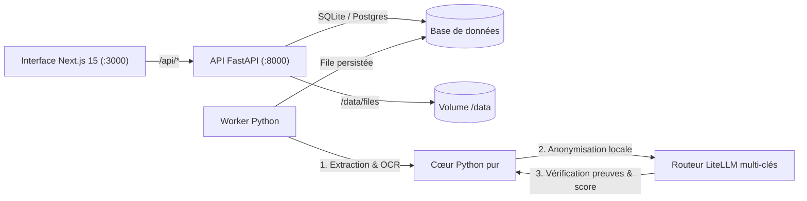

# Shortlist

*[Read in English](README.md)*

**Outil open source et auto-hébergé de présélection de CV par IA avec citations de preuves vérifiables (AGPL-3.0).**

> **L'humain décide toujours :** Shortlist classe les CV par rapport à une grille de critères et cite les phrases exactes du CV. Il indique quels CV lire en premier — **il ne rejette jamais un candidat automatiquement**.

## Installation en 3 commandes

**Linux / macOS :**
```bash
git clone https://github.com/shortlist-org/shortlist.git && cd shortlist
./deploy/init.sh
docker compose -f deploy/docker-compose.yml up --build
```

**Windows (PowerShell) :**
```powershell
git clone https://github.com/shortlist-org/shortlist.git; cd shortlist
.\deploy\init.ps1
docker compose -f deploy/docker-compose.yml up --build
```

`init.sh` / `init.ps1` crée `deploy/.env` et génère une clé Fernet `SHORTLIST_SECRET_KEY` aléatoire au premier lancement.

- **Interface Web :** `http://localhost:3000` (français par défaut, anglais disponible)
- **API & Documentation OpenAPI :** `http://localhost:8000/api/docs`
- **Profils optionnels :** `--profile ollama` (IA 100 % locale) et `--profile postgres` (PostgreSQL au lieu de SQLite).

## Architecture



## Fournisseurs IA supportés

| Fournisseur | Usage typique | Données envoyées hors machine |
| --- | --- | --- |
| **Ollama (local)** | Gratuit, 100 % privé | Non |
| **Google Gemini** | Meilleur rapport qualité-prix (Flash, Flash-Lite) | Oui (anonymisées) |
| **OpenAI** | Modèles GPT | Oui (anonymisées) |
| **Anthropic** | Modèles Claude | Oui (anonymisées) |
| **Mistral** | Fournisseur européen | Oui (anonymisées) |
| **Groq / OpenRouter** | Modèles open source hébergés, offres gratuites | Oui (anonymisées) |
| **Compatible OpenAI** | LM Studio, vLLM, Azure OpenAI | Selon l'hôte |

> **Confidentialité :** Auto-héberger Shortlist ne rend pas votre organisation conforme au RGPD ou à la loi marocaine 09-08 à lui seul. Consultez [PRIVACY.md](PRIVACY.md) et [LIMITATIONS.md](LIMITATIONS.md).

## Documentation

- [Guide Recruteur (FR)](docs/recruiter-guide.fr.md) · [Recruiter Guide (EN)](docs/recruiter-guide.en.md)
- [Guide des fournisseurs IA & coûts](docs/provider-guide.md)
- [Spécification](docs/SPEC.md) · [ADR-001](docs/adr/ADR-001-stack.md)
- [Confidentialité](PRIVACY.md) · [Limites](LIMITATIONS.md) · [Sécurité](SECURITY.md)
- [Contribuer](CONTRIBUTING.md) · [Changelog](CHANGELOG.md)

## Licence

Sous licence **AGPL-3.0-or-later**. Voir [LICENSE](LICENSE).
