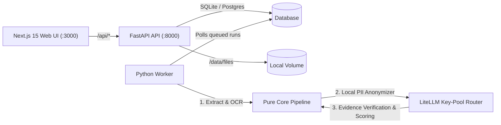

# Shortlist

*[Lire en français](README.fr.md)*

**Open-source, self-hosted AI CV screening tool with verifiable evidence citations (AGPL-3.0).**

> **Human in the loop:** Shortlist ranks CVs against a job's criteria grid and quotes exact evidence from each CV. It tells recruiters which CVs to read first — **it never makes hiring decisions automatically**.

## Quick Start (3 Commands)

```bash
git clone https://github.com/shortlist-org/shortlist.git && cd shortlist
cp deploy/.env.example deploy/.env
docker compose -f deploy/docker-compose.yml up --build
```

- **Web UI:** `http://localhost:3000` (French default, English toggle)
- **API & OpenAPI docs:** `http://localhost:8000/api/docs`
- **Optional profiles:** `--profile ollama` (100% local AI) and `--profile postgres` (PostgreSQL instead of SQLite).

## Architecture



## Supported AI Providers

| Provider | Typical Use | Data Leaves Machine |
| --- | --- | --- |
| **Ollama (local)** | Free, 100% private | No |
| **Google Gemini** | Best cost/performance (Flash, Flash-Lite) | Yes (anonymized) |
| **OpenAI** | GPT models | Yes (anonymized) |
| **Anthropic** | Claude models | Yes (anonymized) |
| **Mistral** | European provider | Yes (anonymized) |
| **Groq / OpenRouter** | Hosted open-weight models, free tiers | Yes (anonymized) |
| **OpenAI-compatible** | LM Studio, vLLM, Azure OpenAI | Depends on host |

> **Privacy Note:** Self-hosting Shortlist does not make your organization compliant with GDPR or Moroccan Law 09-08 on its own. See [PRIVACY.md](PRIVACY.md) and [LIMITATIONS.md](LIMITATIONS.md).

## CLI Usage

```bash
# Screen a folder of CVs offline or with a configured profile
uv run shortlist screen ./cvs --job job.txt --profile economical --out ranking.xlsx

# Run the synthetic evaluation benchmark (30 CVs across 3 jobs)
uv run shortlist eval --fake-llm --eval-dir eval
```

## Documentation

- [Recruiter Guide (EN)](docs/recruiter-guide.en.md) · [Guide Recruteur (FR)](docs/recruiter-guide.fr.md)
- [AI Provider & Cost Guide](docs/provider-guide.md)
- [Specification](docs/SPEC.md) · [ADR-001: Stack](docs/adr/ADR-001-stack.md)
- [Privacy](PRIVACY.md) · [Limitations](LIMITATIONS.md) · [Security](SECURITY.md)
- [Contributing](CONTRIBUTING.md) · [Changelog](CHANGELOG.md)

## License

Licensed under **AGPL-3.0-or-later**. See [LICENSE](LICENSE).
